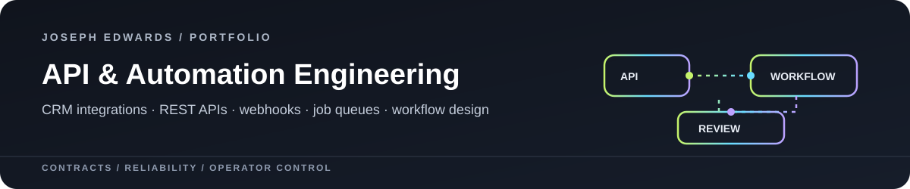
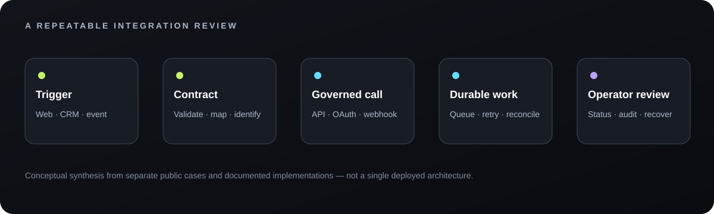

# Joseph Edwards · API & Automation Engineering

I connect business workflows to the systems that must receive, process and preserve their data. Across public source releases, WordPress and CRM builds, research platforms, and commercial Zoho products, my work includes API design, authentication boundaries, integrations, webhooks, asynchronous jobs, workflow automation and operational review.

   

<h2 id="rawops-suite"></h2>

RawOps Suite adds a detailed PHP/MySQL integration case: provider-backed discovery, contextual assistance, scheduled communication and the records that connect one step to the next.

  

28 October 2025: historical email composer with assisted writing, templates, tone and layout controls. This capture establishes the interface; the linked handler exposes its context assembly.

**Evidence scope:** The archive includes 122 API source files, within a wider application and migration history. Source and historical screens are available for inspection. Provider connectivity and end-to-end execution have not been revalidated.

## Choose a case

| Build | API and automation work | What the evidence establishes |
|---|---|---|
| [RawOps Suite](docs/RAWOPS-SUITE.md) | Places search/caching, contextual chat and drafts, sample automation, email queues, callbacks and reporting. | 122 API source files and historical redacted UI evidence; current provider execution remains unvalidated. |
| [OSINT Dive Deep](https://github.com/RawPowered/osint-dive-deep-v1) | Node/Express control plane, authenticated Python/FastAPI research API, provider adapters, job queues, worker tokens, checkpoints, and artifact handling. | Public source release with synthetic contract tests and explicit deployment boundaries. Hosted services and provider execution need operator configuration. |
| [Flow Fountain for CRMs](https://github.com/RawPowered/flow-fountain-for-crms) | REST routes, API-key controls, CRM and SQL integration grants, webhook handlers, workflow authoring, execution review and audit events. | Public GPL source preview v0.1.2. GoHighLevel/LeadConnector is the original CRM adapter; live MySQL and external integration acceptance remain separate. |
| [305UGC Suite](https://github.com/RawPowered/305UGC-Showcase/blob/main/docs/CRM-AND-AUTOMATION.md) | WordPress-to-Zoho CRM request flow, server-side OAuth client, field mapping, stable request identity, API budgeting, caching, retry and access boundaries. | Read-only review confirmed working administrative CRM reads, existing linked Cases and enabled delivery configuration. A new production Lead transaction and end-to-end customer journey were not established. |
| [Zoho widgets and automations](https://github.com/RawPowered/Zoho-CRM-Widgets) | CRM-native workflow and widget products for service operations, project scoping, finance context and task planning. | Public tours use fictional records. Commercial source, installation and deployment evidence are supplied privately; a tour is not a live acceptance result. |
| [RawGraded API and privacy controls](https://github.com/RawPowered/RawGraded) | PHP session APIs, Stripe webhook HMAC handling and server-side response minimization for selected private fields. | Public assurance source for the described routes and boundaries; production credentials and release tooling are not in the public tree. |

## Integration pattern

This is a cross-project reading guide, not one deployed system. Follow each case for its implementation status, version, sources and remaining acceptance work.

## What I bring to an API project

- **Contract thinking:** define payloads, stable IDs, field mappings, validation and version compatibility before connecting systems.
- **Reliable delivery:** preserve a local receipt, record status, avoid duplicate work on retries, respect remote API limits, and reconcile uncertain outcomes.
- **Automation operators can understand:** show configuration, run state, failure context and the next safe action instead of hiding work in a black box.
- **Security and privacy boundaries:** keep credentials server-side, scope machine access, separate identity from record authorization, and minimize public responses.
- **Evidence discipline:** distinguish source-backed implementation, read-only observations, fictional previews, historical configuration and proposed acceptance.

## Interface evidence

**Flow Fountain workflow authoring**: fictional draft and mocked responses in the public preview:

**Dive Deep research workspace**: isolated blank documentation case, no real subjects or results:

## Review the boundaries

This portfolio indexes distinct work; it does not claim every platform runs one shared adapter or that all paths have passed production acceptance. Credentials, customer records, live CRM links, private commercial source and unredacted operational data are excluded. No live CRM records or flows were changed, executed or tested to prepare this portfolio.

**Available for API integration, CRM automation, business-systems and internal-tools roles.** [Connect on LinkedIn](https://www.linkedin.com/in/josephedwardscto/).
